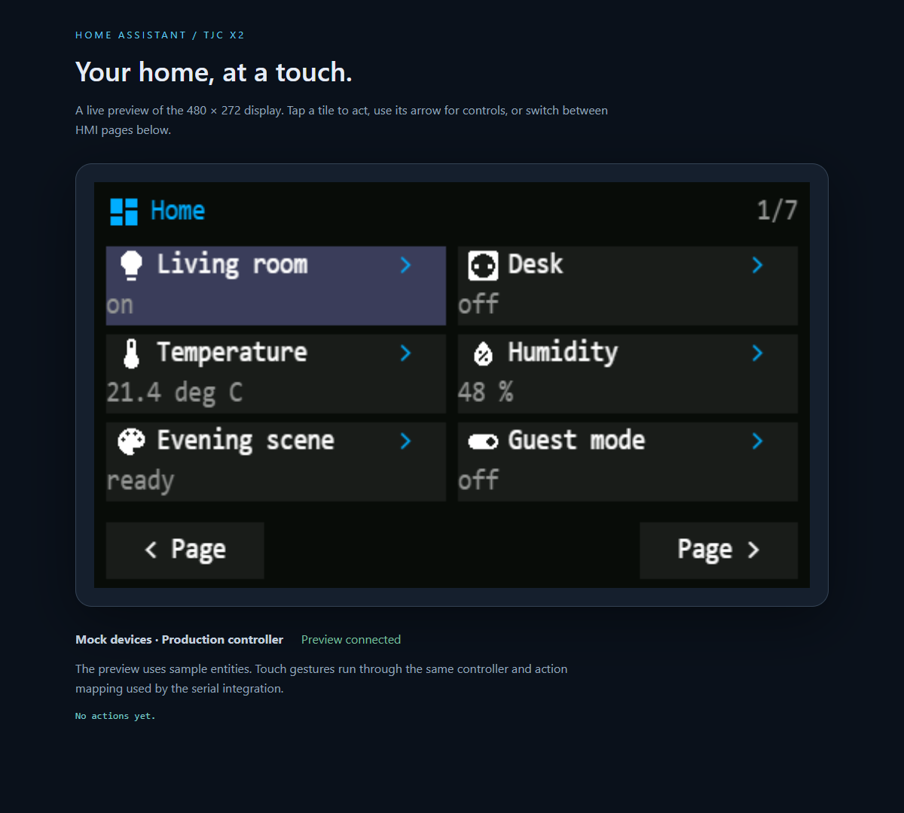
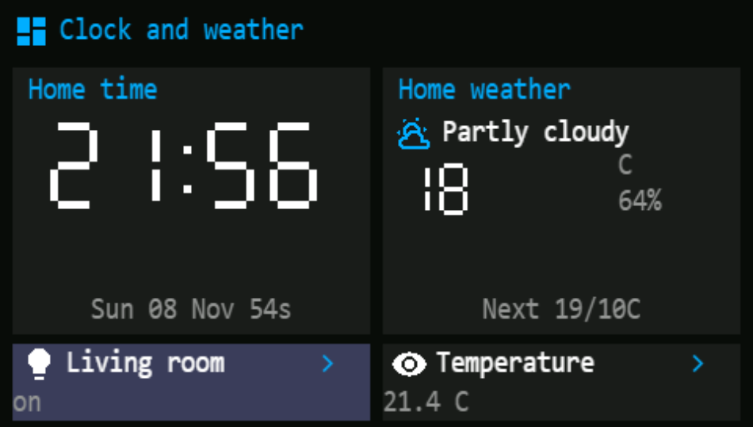
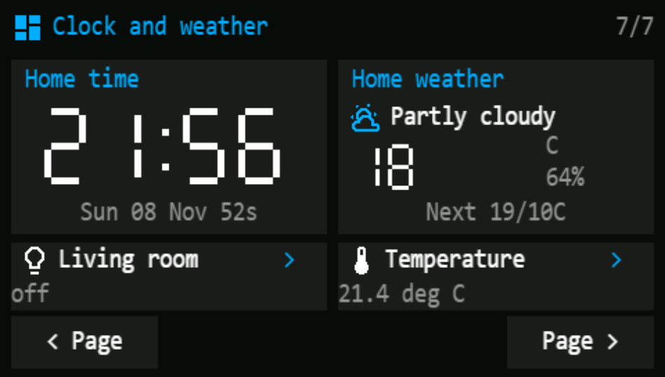

# Home Assistant TJC Serial HMI

Turn a **TJC4827X243_011 (X2)** into a 480 × 272 touch controller for Home Assistant.
Select existing Home Assistant dashboards in the integration or uBridge configuration.
Their titles can be anything. Edit dashboards in Home Assistant; the panel updates
without recompiling its firmware.



## Included

- Flashable [tjc_hmi.tft](firmware/tjc_hmi.tft), compiled for the exact X2 model.
- Editable [tjc_hmi.HMI](firmware/tjc_hmi.HMI), font resource, and readable startup scripts.
- A local [Home Assistant custom integration](custom_components/tjc_hmi), with UI
  setup, YAML import, serial reconnection, live state updates, and touch actions.
- A [desktop tray bridge](docs/BRIDGE.md) for a display connected to a different
  Windows, Linux, or macOS computer. Configure the HA address, API token, and serial
  port by right-clicking its tray icon and choosing **Configuration…**.
- Five [example dashboards](examples/dashboards) and an interactive desktop preview.
- Tests, firmware checksums, and [validation details](docs/VALIDATION.md).

## Install

The release directory contains two ZIPs and a Windows installer:

- `uBridge-0.7.2-windows-x64.msi`: Windows setup wizard for uBridge, with Start menu
  shortcuts, firmware and guides. Installs for the current user; no Python or .NET
  installation is needed to run the installed app.
- `tjc-hmi-0.7.2-install.zip`: Windows tray bridge in `bridge/`, HA integration in
  `custom_components/`, compiled display firmware in `firmware/`, guides and examples.
- `tjc-hmi-0.7.2-source.zip`: editable HMI project, picture sources, Python code,
  tests and build tools. Use this for Linux/macOS source installation.

For a normal Windows installation, run the MSI and start **uBridge** from the Start
menu. It installs under `%LOCALAPPDATA%\Programs\uBridge`. Keep using the ZIP for
copying the HA integration to the HA host, or for a portable desktop installation.

Extract the entire installation ZIP. For a display attached to a **different
computer from HA**, run `bridge/uBridge.exe` and configure the connection.
Choose **Flash display firmware…** in Configuration to upload `firmware/tjc_hmi.tft`
without the vendor editor. The bridge disconnects before flashing; reconnect after
completion. Saved connection settings use the same location as earlier versions.

For a display attached **directly to the HA host**, use the integration:

1. Flash `firmware/tjc_hmi.tft` onto the TJC with a microSD card or the TJC editor.
2. Connect the display's UART to the Home Assistant host using a USB serial adapter.
3. Copy `custom_components/tjc_hmi` into `/config/custom_components/tjc_hmi`, then
   restart Home Assistant.
4. Add **TJC Serial HMI** under **Settings → Devices & services → Add integration**.
   Enter the host's serial path and **115200** baud.
5. Select the dashboards to display from the available HA dashboards in configuration.
   Add supported entity cards to those dashboards as needed.

Follow [the installation guide](docs/INSTALL.md) for wiring, flashing, a complete
YAML example, supported controls, troubleshooting, and rebuilding the firmware.
No MQTT broker, ESPHome controller, or HA add-on is needed. Direct serial mode does
not need an access token; the remote desktop bridge does.

## Updates in 0.7.2

The footer retains its left/centre/right positions. **Items** appears only when the
current view overflows onto multiple Items screens. **< Page** and **Page >** appear
only when multiple display pages are available, including additional dashboard
views. Hidden buttons have no touch targets. Idle mode still hides all navigation
and the page counter; entity-detail Back remains available in normal mode.

When no footer control is needed, content uses the freed space. The page counter
retains its separate rule: normal mode with more than one configured dashboard.



## Updates in 0.7.0

Clock and weather cards work in both uBridge and the direct HA integration. A view
containing one `clock`, one `weather-forecast`, and up to two entity cards uses a
single combined screen: clock/weather above, two interactive tiles below. Use the
[ready-to-use example](examples/dashboards/clock-weather.yaml), replace its entity
IDs, register it in HA, then select it in configuration. No display reflash is needed.



Clocks support digital/analog styles, seconds, 12/24-hour format and time zones.
Standalone weather cards show current conditions and up to five forecast entries;
the compact combined layout shows current conditions and the next forecast summary.
See [clock and weather options](docs/DISPLAY.md#clock-weather-and-two-entity-tiles).

## Updates in 0.6.1

uBridge preloads the available HA dashboards at startup. Choose one from the
**Available dashboards** dropdown and click **Add**; selected dashboards appear
below, with a **Remove selected dashboard** button. Drag rows to reorder, or use
**Refresh** to reload choices. The HA integration also uses a dropdown selector.

## Updates in 0.6.0

- Select dashboards from HA in both the direct integration and uBridge; names no
  longer follow a prefix or numbering rule. Selection uses stable dashboard URLs.
- Choose the existing dim/off sequence or an idle dashboard at an absolute
  brightness (0–100%). Touch restores the previous page and active brightness.
- The desktop bridge is now **uBridge**, with a **uB** icon. Saving repairs sign-in
  registration even if its checkbox was already enabled.
- Direct integration upgrades preserve matching dashboards as explicit selections.
  In uBridge, load the dashboard list and select your pages once after upgrading.

## Updates in 0.5.1

Gauges and graphs now fill the entire content area between header and navigation.
Each gets its own Items sheet. Serial drawing is fixed at eight commands per batch;
the configuration field has been removed and old saved values are ignored.

## Updates in 0.5

- Direct HA connections now share the bridge's idle dim/off/wake policy. Configure
  brightness, delays and dim percentage in the integration's **Configure** options.
- HA-style thick gauges support filled arcs, optional needles, severity and segments.
  Charts have time labels, grid lines and grouped series bars at the panel's resolution.
- Fixed the orange tray indicator when connected in native/vector icon mode.
- Firmware upload from the bridge configuration or the HA `tjc_hmi.flash_firmware`
  action, with model checks and per-block acknowledgement.
- Consolidated release packaging; checksums are inside each ZIP in `SHA256SUMS.json`.

## Behavior and compatibility

Each dashboard's first view becomes its main HMI page. Additional views become
additional pages. Six entity tiles fit on a screen; **Items** cycles through
overflow, **Page** switches dashboards/views, and **>** opens entity controls.

Supported controls include lights, switches, scenes, scripts, buttons, single-target
thermostats, covers, numeric helpers, selects, and basic media playback/volume.
Other entities show their state. Explicit dashboard `tap_action` service calls,
confirmation prompts, and navigation to HMI pages are supported.

The display supports incremental state updates, MDI dashboard/entity icons, header
badges, gauges, current-value bars, history lines, and statistics line/bar charts.
The bridge dims after 60 seconds to 50% of its configured brightness, then switches
the backlight off after another 60 seconds. Touch restores brightness; the wake
gesture does not operate a device. Choose dim/off or a dedicated idle dashboard in Configuration (or integration options).
Version 0.4 preloads all 7,448 bundled MDI icons into display flash in five color
palettes. An icon becomes one native picture command. Bounded serial batches
(fixed eight commands, at most 256 bytes) reduce acknowledgement round trips.
The bridge detects the matching picture pack automatically and uses vector drawing
with older TFTs. Native icons require flashing the new 4,589,300-byte TFT once.
See [rich display support](docs/DISPLAY.md) and [chart examples](examples/dashboards/charts.yaml).

This is a native serial UI with a documented subset of Lovelace cards. Browser
layouts, arbitrary custom cards, pictures, and JavaScript are not rendered.
Admin-only dashboards and cards/views with visibility rules are skipped. Text is
converted to ASCII, including accent transliteration, and long labels are shortened.

Verified with **Home Assistant 2026.10.4**, Python 3.14 on Linux, and **USART HMI
1.68.2**. Older Home Assistant versions are not certified. Dashboard loading uses
HA's internal Lovelace API, so a future HA change may require an adapter update.
The new firmware compiled with **0 errors and 0 warnings**. Native pictures from
all five palettes were checked in the vendor simulator, and all 170 imported
picture resources were checked against their source and compiled payloads.
The previous TFT was flashed and checked through COM4; [that flash record](docs/FLASH-COM4.json)
applies to the earlier binary. The new icon TFT, physical touch operation, and
connection to a personal HA instance still require hardware verification.

## Try the interactive preview

From the source project directory, using Python 3.13 or later:

```sh
python -m venv .venv
# Activate the venv: Windows .venv\Scripts\activate; Linux/macOS source .venv/bin/activate
python -m pip install -e '.[dev]' aiohttp==3.14.5
python tools/preview.py
```

Open [the local preview](http://127.0.0.1:8765). Click the screen to toggle mock
entities, change pages, adjust a thermostat, select options, and confirm a script.
It runs the production renderer/controller against simulated states; no real
devices or serial port are used. Stop it with Ctrl+C.

## Develop and package

```sh
ruff check custom_components tjc_bridge tests tools
ruff format --check custom_components tjc_bridge tests tools
pytest -q
python tools/check_firmware.py
python tools/package.py
```

On a Linux Python 3.14 environment with `homeassistant==2026.10.4` installed:

```sh
python tools/check_homeassistant.py
python tools/check_recorder.py
```

The optional browser check requires `playwright` and Google Chrome, with the preview
server running: `python tools/check_preview.py`. It writes screenshots to `docs/`.

The two release ZIPs in `dist/` contain embedded `SHA256SUMS.json` manifests.
The installation ZIP contains the Windows application, integration, dashboards,
firmware and guides. The source ZIP contains editable firmware, code, tools, tests,
project settings and CI. Application code is MIT licensed; see
[third-party notices](THIRD_PARTY_NOTICES.md) for the vendor compiler and font.
