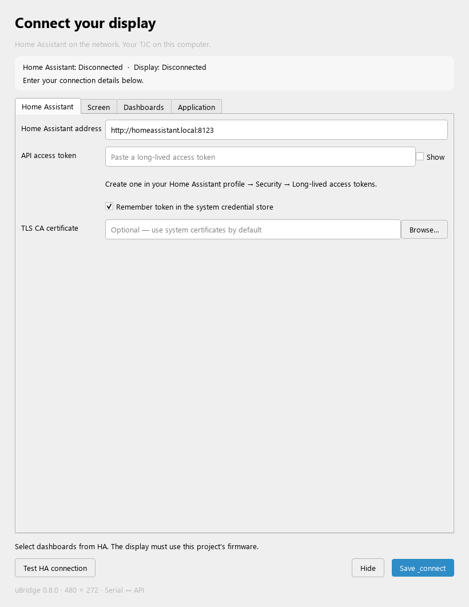

# uBridge — remote serial display

uBridge runs on the Windows, Linux or macOS computer with the USB serial adapter.
It connects to Home Assistant through the authenticated WebSocket API and renders
selected dashboards on the TJC panel. The HA host needs no integration in this mode.
Use the direct integration when the UART adapter is attached to the HA host instead.

## Windows MSI installer

Run `uBridge-0.8.0-windows-x64.msi` and complete the setup wizard. It installs the
64-bit application for the current user in `%LOCALAPPDATA%\Programs\uBridge`,
with **uBridge** and guide shortcuts in the Start menu. Python, .NET and the vendor
HMI editor are not required on the target PC. Firmware is included in the installed
`firmware/` folder and can be uploaded from uBridge's Configuration window.

Quit any running portable/older uBridge before installing or updating. Existing
connection settings and the credential-store token retain their previous locations.
If Start at sign-in was enabled for a portable copy, open the installed app and
click **Save & connect** to update startup registration to its installed location.
Startup remains an app setting, rather than being enabled automatically by setup.

Leave **Run uBridge** checked on the final setup page to open the application.
The first launch after installation asks whether the TJC needs flashing, with
**Yes** recommended. Select the local serial port and baud rate in the next dialog
and confirm **Download & flash**. Home Assistant credentials are not needed to
flash. Choosing No or cancelling leaves flashing available on the **Screen** tab.

Future MSI versions upgrade this installation. Remove it through **Windows Settings
→ Apps → Installed apps → uBridge → Uninstall**. Disable **Start at sign-in** in the
app before uninstalling. Uninstall removes installed files and shortcuts; saved
connection settings and credentials remain so they can be reused after reinstalling.
The MSI installs the Windows bridge; deploy the HA integration separately from the
installation ZIP to your HA host when using direct serial mode.

## Windows portable application

Extract **all** of `tjc-hmi-0.8.0-install.zip`, then run `bridge/uBridge.exe`.
Keep its `_internal` directory beside the executable. Right-click the **uB** tray
icon and select **Configuration…**. Green means HA and display are connected;
orange means a connection is still pending or disconnected.

Quit an older bridge before starting this release against the same serial port.
Settings and saved credentials retain their previous locations for compatibility.
After upgrading from prefix-based selection, choose dashboards from the HA dropdown and add
them to the display list once. No dashboard title or URL needs to change.



## Configure

Settings are grouped into four tabs:

- **Home Assistant**: server address, access token, credential storage and CA file.
- **Screen**: serial connection, brightness, idle behavior and firmware upload.
- **Dashboards**: available and selected dashboards, ordering and refresh.
- **Application**: startup options and release-check status.

The window follows the operating system's light/dark appearance, including changes
while running. Disabled settings and their labels are gray. The system tray icon
remains green when connected and orange when waiting or disconnected.

1. Enter the HA base address, for example `http://homeassistant.local:8123`, and a
   long-lived access token from your HA profile → Security.
2. The available dashboard list loads automatically at startup with saved HA
   credentials, and after entering the address/token. **Refresh** reloads it on
   demand. Discovery only reads HA; it does not require or open the serial port.
3. Choose a dashboard in **Available dashboards** and click **Add**. The selected
   dashboards appear in the list below. Select a row and click **Remove selected
   dashboard** to remove it. Drag rows into the desired order. Dashboard titles
   may be anything; selection is stored by URL and survives title changes. Both
   UI and YAML dashboards are supported, including hidden-sidebar dashboards.
   Admin-only dashboards are excluded, and HA token permissions still apply.
4. Choose the display's local serial port and **115200** baud for the supplied TFT.
5. Configure brightness and idle behavior, then click **Save & connect**.

Use **Refresh** after creating dashboards or changing connection details. A
saved selection which was deleted is marked unavailable; remove it and add
its replacement. Dashboard cards and views update through events and periodic
refreshes without needing to reload the list manually.

Use explicit editable cards. Generated strategies must first be converted using
**Take control** in HA. Card support is described in [DISPLAY.md](DISPLAY.md).

## Display navigation

The three footer positions stay fixed: **< Page** at left, **Items** in the centre
and **Page >** at right. Each control is shown only when useful:

- **Items** appears and responds to touch only if the current dashboard view needs
  more than one Items screen. It cycles overflow entities/cards even when only one
  dashboard/page is configured.
- **< Page / Page >** appear only if multiple display pages are available, including
  additional views within one selected dashboard.

Unused positions stay blank and have no navigation touch target. If no footer
control is needed, the layout extends to the panel bottom. The top-right page
counter retains its separate configuration rule: normal mode with more than one
selected dashboard. Entity detail screens retain their Back button.

Idle dashboard mode always hides all footer navigation and the page counter. It
shows the idle dashboard's first view/Items screen; touching wakes the display and
restores the normal layout.

## Clock, weather and two tiles

Use [clock-weather.yaml](../examples/dashboards/clock-weather.yaml) as a new HA
dashboard and replace its weather/light/sensor IDs. Select that dashboard in
uBridge. One clock, one weather forecast card and up to two entity cards share a
single Items screen. The entity tiles retain their normal actions and details.
The same layout works in a dedicated idle dashboard. See [DISPLAY.md](DISPLAY.md)
for supported card options and forecast/time-zone behavior.

## Idle display

**Backlight** is the active brightness (1–100%). Enable idle behavior and choose:

- **Dim, then turn off**: after **Idle after** seconds without touch (default 60),
  dim to **Dimmed brightness** percent of active brightness (default 50%). Turn the
  backlight off after **Then turn off after** additional seconds (default 60).
  Active 80% therefore produces 80 → 40 → 0.
- **Show a dashboard**: after **Idle after** seconds, show the selected idle
  dashboard's first view at **Idle dashboard brightness**, an absolute 0–100%.
  It remains there until touched, without the second dim/off stage. This dashboard
  may be separate from the normal selected dashboards. States and charts stay live.

Any touch restores active brightness and the previous normal page. The wake gesture
is consumed, including when idle and active brightness happen to be identical.
Touch again to operate a device. State changes never reset the timer. At brightness
0 only the backlight switches off; the controller remains awake for touch/serial.
Idle handling continues while the network is offline, though HA data is unavailable.
The direct integration offers the same settings under **Configure**.

## Start at sign-in

Enable **Start at sign-in**, **Connect automatically**, and **Remember token**, then
click **Save & connect**. Without a persistent token the app must ask for it after
login. Every save repairs registration using the current absolute executable and
configuration paths, even if the checkbox was already enabled. Re-save after moving
the portable folder. Keep that folder and its libraries on a local disk available
at login. Startup opens in the tray when configuration and credentials are valid.

Windows uses the current user's Run entry named **uBridge**. Linux uses
`~/.config/autostart/ubridge.desktop` (respecting `XDG_CONFIG_HOME`); macOS uses
`~/Library/LaunchAgents/io.ubridge.desktop.plist`. Old startup names are removed on
save. Source installs explicitly include their module location so login startup
works independently of the login working directory. Turning the checkbox off and
saving removes registration. OS startup policy must also allow the app; this
release has not been verified across a real sign-out/sign-in cycle.

## Tray menu

- **Configuration…** opens connection and display settings.
- **Reconnect** restarts using saved settings and the session token.
- **Reload dashboards** forces dashboard/card configuration to reload.
- **Disconnect** releases the UART and network connections.
- **Open log folder** opens settings and rotating logs.
- **About…** displays `uBridge version 0.8.0 - (c) 2026 umbacos`.
- **Quit** stops the app and releases the serial port.

HA/serial failures retry automatically. Actions interrupted by network failures are
never replayed, because HA may already have performed them. The display does not
operate devices while HA is disconnected. Double-clicking the tray icon also opens
Configuration on supported desktops. If no tray exists, the window remains usable.

## Firmware upload

On the **Screen** tab, use **Download & flash recommended firmware…** to obtain
firmware from [umbacos/uBridge](https://github.com/umbacos/uBridge). Confirm the
local serial port before downloading. uBridge prefers the latest stable release's
installation ZIP, or files at that release's tag. If no releases have been published,
it resolves `main` to a single commit and downloads both files from that commit.
The downloaded model, byte count and SHA256 must match `firmware/build.json` before
upload can start. Download or validation failures leave the display untouched.

For an offline file, use **Flash local firmware…** and choose `firmware/tjc_hmi.tft`.
The app stops its serial worker before upload. Keep the display powered throughout
upload; reconnect after it reboots. The uploader checks the TJC model, enters upload
mode and requires acknowledgements for every block. See [INSTALL.md](INSTALL.md)
for wiring, power and microSD/editor alternatives. Changes in 0.6 require updating
the app/integration, without reflashing a display already running the native icon TFT.

## Release notifications

While uBridge runs, it checks the public GitHub releases API at most once per 24
hours. The last check is saved across restarts; failed requests also wait 24 hours
before retrying automatically. **Application → Check now** requests an immediate
check. No GitHub account or Home Assistant token is used for these requests.

A newer stable version produces a notice at the top of Configuration. Click it to
open the release page and download an installer. Updates are not installed
automatically. Drafts and prereleases are ignored. With no published releases,
Application reports that status. Release-check and first-run state are stored in
`config.desktop.json` next to the regular configuration; verified firmware is
cached in the adjacent `firmware/` folder. Installed Windows copies record each
installation separately so the firmware question appears again after reinstalling
or upgrading. Portable/source copies ask once per application version.

## Linux and macOS from source

Use Python 3.13 or later and the source ZIP:

```sh
python3 -m venv .venv
source .venv/bin/activate
python -m pip install '.[bridge]'
ubridge --configure
```

Linux needs Qt desktop libraries, a tray/status notifier and permission to open the
adapter (often the dialout/uucp group). GNOME may need a tray extension. Prefer
`/dev/serial/by-id/...`. macOS adapters normally use `/dev/cu.*`. Credential storage
needs an unlocked Secret Service/KWallet or macOS Keychain. Native Linux/macOS tray
and real login behavior have not been exercised; Linux engine/API checks are separate.

Build a native portable binary on its target OS:

```sh
python -m pip install '.[bridge,build]'
python tools/build_bridge.py
```

PyInstaller outputs `.cache/portable/uBridge/`; the Windows executable cannot run on
Linux/macOS. Keep bundled Qt libraries and licenses with the program.

## Build and verify the MSI

On Windows, first build the portable app, then run:

```sh
python tools/build_msi.py
python tools/check_msi.py
python tools/package.py
```

The builder uses the .NET 8 runtime and a workspace-local WiX 5.0.2 toolchain from
NuGet, with both tool packages pinned by SHA256. No global WiX installation or
.NET SDK is needed. The target PC does not need .NET. Generated WiX authoring,
license RTF and compiler intermediates stay in `.cache/`.

`package.py` builds the MSI and both release ZIPs, then keeps only those three current
artifacts in `dist/`. `check_msi.py` decompiles the MSI, checks its install scope,
wizard/shortcuts and every installed file's path and SHA256, then runs the extracted
application's offline diagnostics without installing it in the current user profile.

## Headless operation

```sh
ubridge --headless --config /path/to/config.json
```

The `python -m tjc_bridge` entry point is also supported. Without Qt, install `.`
plus `aiohttp==3.14.5` and `keyring==25.7.0`. Headless mode reads the saved system
credential or `TJC_HA_TOKEN`; that environment variable is never written to JSON.

Example non-secret configuration (dashboard values are URL paths, not titles):

```json
{
  "base_url": "http://homeassistant.local:8123",
  "serial_port": "/dev/serial/by-id/usb-YOUR_ADAPTER",
  "baudrate": 115200,
  "dashboards": ["home-panel", "climate-panel"],
  "brightness": 80,
  "idle_enabled": true,
  "idle_mode": "dashboard",
  "idle_dim_seconds": 60,
  "idle_dashboard": "charts-panel",
  "idle_brightness": 25,
  "remember_token": true,
  "connect_on_launch": true,
  "start_at_login": false,
  "ca_file": ""
}
```

Tokens stay in Windows Credential Manager, macOS Keychain or a supported Linux
credential store. JSON holds only the credential identifier. If the vault is
unavailable, the token is kept for the session and requested again next launch.
There is no plaintext-token fallback. TLS certificate verification remains enabled;
choose a private CA PEM file if needed. Do not put tokens in URLs or CLI arguments.

Settings and rotating `bridge.log` files retain their legacy locations:

- Windows: `%APPDATA%\TJCBridge\`
- Linux: `$XDG_CONFIG_HOME/tjc-bridge/`, normally `~/.config/tjc-bridge/`
- macOS: `~/Library/Application Support/TJCBridge/`

Logs redact the active token. If HA connects but the panel does not, check local
port ownership, baud and firmware. If no pages load, check dashboard selection and
supported cards. The supplied native icon TFT reports **Connected (native icons)**;
older compatible TFTs use **Connected (vector icons)**.

`uBridge.exe --diagnostics diagnostics.json` checks bundled imports and credential
backend without contacting HA or the panel. [Validation](VALIDATION.md) describes
isolated network/UART tests and physical hardware limitations. The Windows binary
is unsigned. The release packages contain dependency licenses and checksum manifests.

HA references: [authentication](https://developers.home-assistant.io/docs/auth_api/),
[WebSocket API](https://developers.home-assistant.io/docs/api/websocket/),
[dashboards](https://www.home-assistant.io/dashboards/dashboards/).
